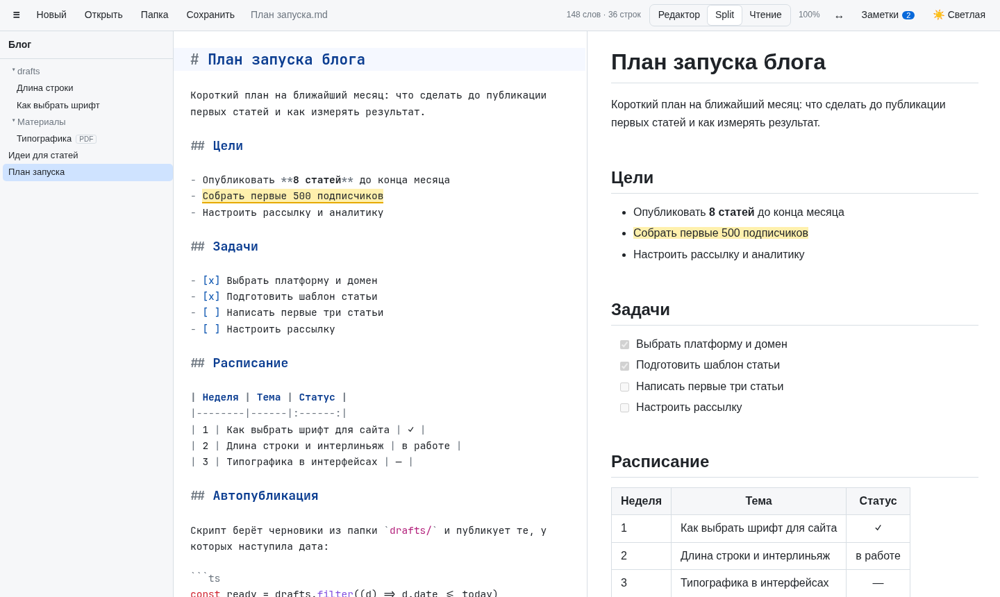
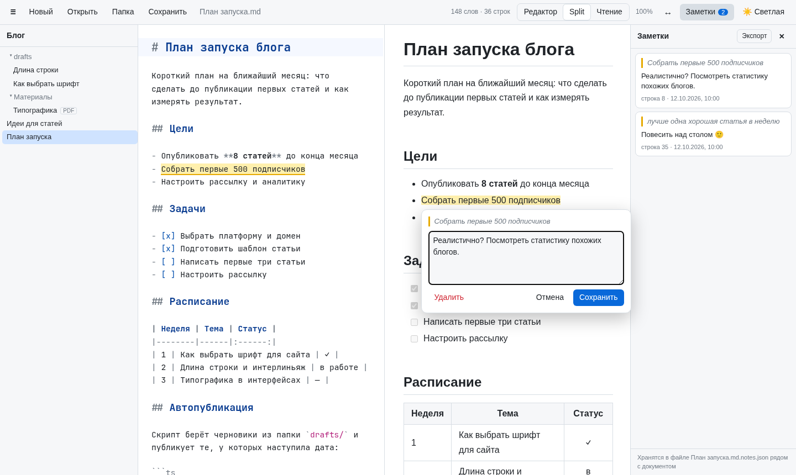
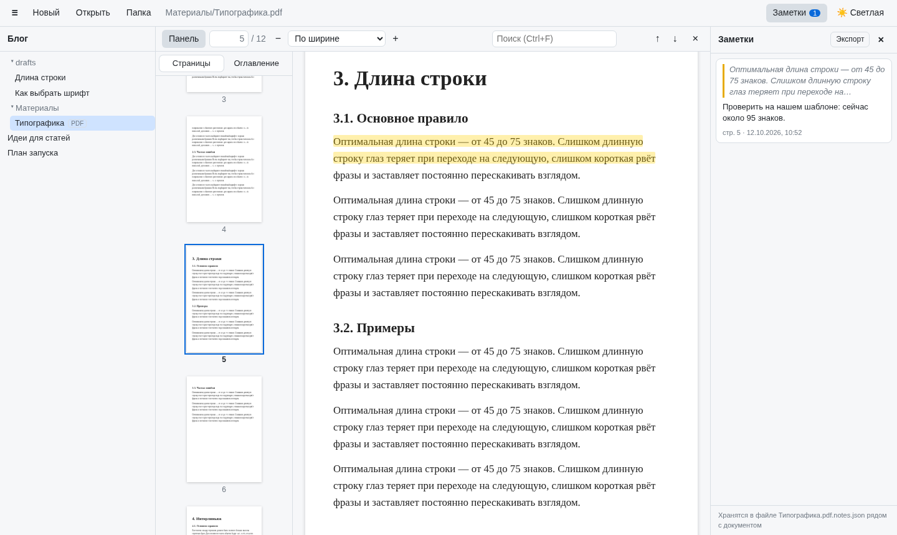
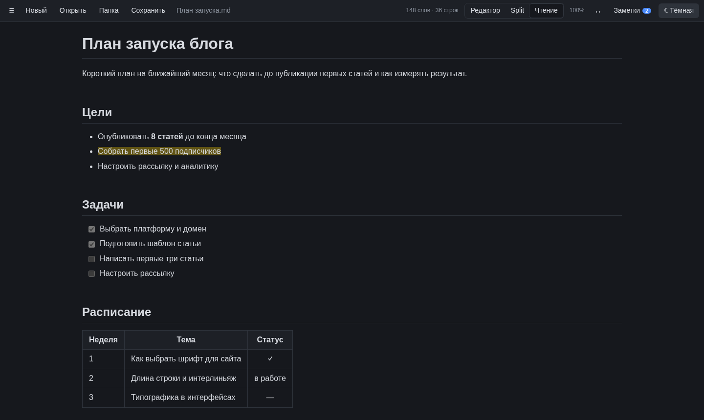

# MD Editor

[Русский](README.md) · **English**

A fast Markdown editor and PDF reader that runs in your browser. Everything stays local: no servers on the internet, files are read and written directly on your disk.



> The interface is in Russian. The screenshots show demo content.

## Features

- **Markdown:** syntax-highlighting editor (CodeMirror 6) and a live preview with synchronized scrolling. Editor, Split and Reading modes. GFM tables, task lists, code highlighting.
- **Speed:** Markdown is parsed in a Web Worker, and the preview only updates the blocks that changed. Multi-megabyte files stay responsive.
- **Files and folders:** `Ctrl+S` writes straight to the file on disk. Folder tree, drag & drop, automatic draft saving.
- **PDF:** page thumbnails, outline, text search, zoom, dark mode for pages.
- **Notes on text:** select a passage in a note or a PDF and attach a comment. Notes are stored in `*.notes.json` next to the document and can be exported to Markdown.
- **Memory:** reading position and zoom are remembered for every document.
- Light and dark themes, adjustable text width.

| Notes on text | PDF reader |
|---|---|
|  |  |



## Quick start

```sh
git clone https://github.com/Gadzhik/mdeditor.git
cd mdeditor
./mdeditor
```

You need [Node.js](https://nodejs.org) 20+ and a Chromium-based browser (Chrome, Chromium, Edge, Brave). The script installs dependencies, builds the app and opens it in its own window. See [Installation and launch](#installation-and-launch) for details.

## Contents

- [Installation and launch](#installation-and-launch)
- [Usage](#usage)
- [Reading PDFs](#reading-pdfs)
- [Notes on text](#notes-on-text)
- [Keyboard shortcuts](#keyboard-shortcuts)
- [Browser support](#browser-support)
- [Troubleshooting](#troubleshooting)
- [For developers](#for-developers)
- [License](#license)

## Installation and launch

**Requirements**
- [Node.js](https://nodejs.org) 20 or newer (check with `node -v`)
- A Chromium-based browser: Chromium, Chrome, Brave, Edge or Vivaldi. Firefox works too, with limitations (see [Browser support](#browser-support)).

There is nothing else to install. The app folder contains the **`mdeditor`** launcher script (Linux and macOS):

```sh
cd /path/to/mdeditor
./mdeditor
```

On first launch it installs dependencies and builds the app, so the first start takes a while. After that it is instant. The script:
- rebuilds the app only when the sources have changed;
- starts a local server in the background if it is not already running;
- opens the editor in a separate window without tabs or address bar (the `--app` mode of Chromium-based browsers). If no such browser is found, the address opens in your default browser.

The server keeps running after you close the window, so the next launch opens immediately. It uses almost no resources. To stop it: `./mdeditor stop`.

To use your own browser instead, run `./mdeditor serve` and open the printed address (`http://localhost:4317/`).

**Windows.** The script is written in bash, so on Windows build and start the app manually:

```sh
npm install
npm run build
npx vite preview
```

then open the address printed by the last command (usually `http://localhost:4173/`).

### All commands

```
./mdeditor            build (if needed), start the server and open the editor window
./mdeditor serve      only start the server and print the address
./mdeditor stop       stop the background server
./mdeditor status     show whether the server is running
./mdeditor install    (optional) app menu shortcut and the mdeditor command
./mdeditor uninstall  remove the shortcut and the command
./mdeditor default    make MD Editor the default app for .md and .pdf
./mdeditor undefault  restore the previous default apps for .md and .pdf
```

The default port is `4317`. Use a different one like this: `MDEDITOR_PORT=5000 ./mdeditor`.

### Menu shortcut (optional)

To launch the editor from your application menu rather than from the folder, run `./mdeditor install`. It adds an **MD Editor** shortcut with an icon (`~/.local/share/applications/mdeditor.desktop`) and an `mdeditor` command in `~/.local/bin` that you can run from any terminal. The shortcut points to the current folder location, so run the command again if you move the folder. To remove it: `./mdeditor uninstall`.

### Default app for .md and .pdf

MD Editor can be installed as an app (PWA) and made the default for Markdown and PDF files: they then open in it on double-click in your file manager, and `Ctrl+S` writes straight back to the opened file. A Chromium-based browser is required.

1. Run `./mdeditor default`. A browser window with the editor opens.
2. Click the **Установить** (Install) button in the editor toolbar (or the install icon in the address bar) and confirm.
3. Run `./mdeditor default` again. The script finds the installed app and assigns it to `text/markdown` and `application/pdf`.

The previous default apps are remembered; restore them with `./mdeditor undefault`. Once installed, `./mdeditor` launches the installed app.

**Without the server.** The installed app caches itself (service worker) and opens even when the local server is not running, including when a file is opened from the file manager. The server is only needed to pick up a new version after updating the code: run `./mdeditor`, and the app updates the next time it opens.

The first time you open a file, the browser may ask for permission to open such files in MD Editor, and the first time you save, for permission to write to the file.

## Usage

### Interface

In the top toolbar:

- **☰** shows or hides the sidebar with the folder tree.
- **●** before the file name means there are unsaved changes.
- The word and line count is shown on the right.
- **Редактор / Split / Чтение** (Editor / Split / Reading) switch the mode: source only, source and preview, preview only (for reading).
- **100%** shows the text zoom of the current note. Click to reset to 100%.
- **↔** sets the text width in the preview: a slider from 500 to 2000 px or the "full width" checkbox. Double-click the slider to reset to 1200 px. The setting is remembered.
- **Заметки** (Notes) opens the notes panel (see [Notes on text](#notes-on-text)).
- **◐** cycles the theme: auto (follows the system), light, dark.
- Drag the divider between editor and preview to resize. Double-click it to reset to 50/50.

Editor and preview scrolling is synchronized: scroll one and the other follows.

### Working with files

| Action | How |
|---|---|
| Open a file | **Открыть** (Open) or `Ctrl+O` (Markdown or PDF) |
| Save | **Сохранить** (Save) or `Ctrl+S`. Changes are written directly to the original file on disk |
| Save as | `Ctrl+Shift+S` |
| New document | **Новый** (New) |
| Open by dragging | Drop a `.md` or `.pdf` file (or a folder) onto the window |

The first time you save to a file, the browser asks for permission to edit it. That is expected; allow it.

If the document has unsaved changes, the editor asks for confirmation before opening another file.

### Working with a folder (notes, documentation)

1. Click **Папка** (Folder) and choose a directory (or drop it onto the window).
2. A tree of all `.md` and `.pdf` files appears on the left (PDFs carry a "PDF" badge). Service folders (`node_modules`, `.git`, hidden ones) are skipped.
3. Click a file to open it.

While a folder is open:
- **images** with relative paths (``) are shown in the preview;
- **links** to other notes (`[guide](docs/guide.md)`) open in the editor on click, and links to PDFs (`[book](books/book.pdf)`) open in the reader.

The folder is remembered between launches. After a browser restart a **«Восстановить доступ»** (Restore access) button may appear: click it to grant permission again (the browser requires this).

### Position and zoom

For every note the app remembers where you stopped (in any mode, including Reading), the cursor position and the text zoom. Everything is restored the next time you open the file. Files are recognized even after renaming (in Chromium).

Change the text zoom with `Ctrl+=` / `Ctrl+−` or `Ctrl+mouse wheel`, and reset it with `Ctrl+0`. It applies to both editor and preview and does not touch the browser's page zoom. New notes open with the last zoom you set.

When you switch modes (Editor / Split / Reading), the visible passage stays on screen.

### Draft

Text is saved in the browser automatically half a second after every edit and restored on the next launch together with the cursor position. Even an unsaved document survives closing the window.

The draft lives only in this browser and does not replace saving to a file.

### What the preview supports

- Headings, lists, blockquotes, links, images, tables, horizontal rules
- Task lists: `- [ ]` and `- [x]`
- Highlighted code blocks: js, ts, python, bash, json, css, html, yaml, rust, go, java, kotlin, c, cpp, c#, php, ruby, swift, lua, sql, diff, dockerfile, ini/toml, makefile, nginx
- Automatic links from `https://…` addresses
- HTML inside Markdown (unsafe tags and scripts are stripped)

## Reading PDFs

A PDF opens the same way as a note: via **Открыть** (`Ctrl+O`), from the folder tree, through a link in a note, or by dragging. The reader replaces the editor and has its own toolbar:

| Control | What it does |
|---|---|
| **Панель** (Panel) | Shows or hides the left panel with two tabs. **Страницы** (Pages): thumbnails of all pages, the current one highlighted; click to go to a page. **Оглавление** (Outline): the PDF bookmarks; click to go to a section. The chosen tab is remembered; if the file has no outline, Pages opens |
| **N / M** | Current page out of total. Type a number and press `Enter` to jump |
| **− / zoom / +** | Zoom: fit width, whole page, or a percentage. `Ctrl+mouse wheel` zooms around the cursor |
| **Search** | Searches the whole document, highlights every match and shows "current / total". `Enter` goes to the next match, `Shift+Enter` to the previous one, `Esc` clears the search |
| **◑** | Dark theme only: inverts the pages so the white sheet does not glare. Click again to restore the original colors |
| **✕** | Closes the PDF and returns to the note |

- **Text can be selected and copied** like on a normal page.
- **The position is remembered** for every PDF: page, place on the page and zoom. The next time you open the same file, reading continues where you left off, even if the file was renamed.
- **A new PDF** opens with the last zoom you set (fit width by default).
- **The last PDF reopens** on restart if it was opened via Open, from a folder, or by dragging in Chromium. If the browser has forgotten the permission, the note opens instead.
- **The note draft is untouched:** the PDF opens on top, and **✕** or clicking the note in the tree takes you back without losing anything.
- Password-protected PDFs: the reader asks for the password.
- Large PDFs open quickly: pages and thumbnails are rendered only as you scroll.

PDFs are read-only: annotations and editing are not supported.

## Notes on text

You can attach a note to any passage of a Markdown note or a PDF.

1. Select text: in the preview, in the editor, or in a PDF.
2. Click the **＋ Заметка** (+ Note) button that appears next to it (or press `Alt+N`).
3. Type the note and click **Сохранить** (Save) or press `Ctrl+Enter`. You can leave the text empty; the passage then simply stays highlighted.

Passages with notes are highlighted in yellow. Clicking a highlight in the preview or PDF opens the note for editing or deletion. In the editor the note text shows up as a tooltip on hover.

The **Заметки** (Notes) toolbar button, with the note count, opens a list of all the document's notes on the right, ordered by their position in the text. Clicking a note takes you to its passage and briefly highlights it. **Изменить** (Edit) and **Удалить** (Delete) buttons appear on hover.

**Export to Markdown.** The **Экспорт** (Export) button in the notes panel header offers:
- **Save to .md file:** saves `<document>.notes.md` (`doc.notes.md` for `doc.md`, `book.pdf.notes.md` for `book.pdf`). In Firefox the file is downloaded;
- **Copy as Markdown:** to the clipboard, for example to paste into another note;
- **Open in the editor:** as a new unsaved document that you can extend and save with `Ctrl+S`.

The export contains all the document's notes in text order: location (page N or line N), the quoted passage, the note text and the date. Notes whose passage was deleted are marked.

**Where notes are stored.** If the document is in an open folder, notes are saved to a file next to it: `book.pdf.notes.json` for `book.pdf`, `doc.md.notes.json` for `doc.md`. You can keep, copy and sync them along with your documents. If no folder is open, notes are stored in the browser. Once you open the folder containing that document, they move to the file on the next change. The bottom of the panel says where the current document's notes live.

**Editing the text.** In Markdown a note is anchored to the passage itself, not to a line number. If you add or remove text around it, the note stays on its passage. If you delete the passage entirely, the note is not lost: it is marked "фрагмент не найден" (passage not found) in the list. You can select in either the preview or the editor: `**bold** text` in the source and "bold text" in the preview count as the same passage.

## Keyboard shortcuts

**General**

| Keys | Action |
|---|---|
| `Ctrl+O` | Open a file |
| `Ctrl+S` | Save |
| `Ctrl+Shift+S` | Save as |
| `Alt+1` / `Alt+2` / `Alt+3` | Editor / Split / Reading |
| `Ctrl+\` | Sidebar |
| `Alt+[` / `Alt+]` | Narrower / wider preview text (100 px step) |
| `Ctrl+=` / `Ctrl+−` / `Ctrl+0` | Note text zoom: in / out / 100% |
| `Ctrl+wheel` | Note text zoom |
| `Alt+N` | Note on the selected passage (PDF too) |
| `Ctrl+Enter` / `Esc` | Save / close a note (in the note window) |
| `Ctrl+B` / `Ctrl+I` | Bold / italic (press again to remove) |
| `Ctrl+F` | Find and replace |
| `Ctrl+Z` / `Ctrl+Shift+Z` | Undo / redo |
| `Tab` / `Shift+Tab` | Indent / outdent |

**In the PDF reader**

| Keys | Action |
|---|---|
| `Ctrl+F` | Search the PDF |
| `Enter` / `Shift+Enter` | Next / previous match (in the search field) |
| `Esc` | Clear the search |
| `Ctrl+=` / `Ctrl+−` | Zoom in / out |
| `Ctrl+0` | Fit width |
| `Ctrl+wheel` | Zoom around the cursor |
| `PageUp` / `PageDown`, arrows | Scroll pages |

On macOS use `Cmd` instead of `Ctrl`.

## Browser support

| Feature | Chromium, Chrome, Edge, Brave | Firefox, Safari |
|---|---|---|
| Editor, preview, draft | ✓ | ✓ |
| `Ctrl+S` writes directly to the file on disk | ✓ | ✗ file is downloaded |
| Opening a folder and the tree | ✓ | ✗ |
| Reading PDFs | ✓ | ✓ |
| Reopening the last PDF on launch | ✓ | ✗ |
| Window without tabs (shortcut) | ✓ | ✗ opens a tab |

The reason is that direct file access (the File System Access API) is currently available only in Chromium-based browsers.

## Troubleshooting

**Double-clicking in the file manager does not start it.** Many file managers open scripts in a text editor. Run it from a terminal (`./mdeditor`) or enable running executables in your file manager's settings.

**The shortcut did not appear in the menu.** Restart the launcher or log out and back in. Check that the file exists: `ls ~/.local/share/applications/mdeditor.desktop`.

**`mdeditor: command not found`.** `~/.local/bin` is not in your `PATH`. Add `export PATH="$HOME/.local/bin:$PATH"` to `~/.bashrc` or `~/.zshrc`, or run `./mdeditor` from the project folder (that works without `install` too).

**"порт 4317 занят другим приложением" (port 4317 is used by another application).** Use another port: `MDEDITOR_PORT=4318 mdeditor`.

**"сервер не запустился" (the server did not start).** Check the log: `$XDG_RUNTIME_DIR/mdeditor-$USER/server.log`.

**The project is on a removable drive.** The shortcut only works while the drive is mounted at the same path.

**The draft changed to old text.** The draft is tied to the browser and the address. If you open the editor on a different port or in a different browser, it has its own draft.

**A file opened from the terminal (`xdg-open file.md`) does not open in MD Editor.** File managers detect `.md` as `text/markdown`, but `xdg-open` on Hyprland and other non-GNOME/KDE environments often detects it as `text/plain` and opens a text editor. Opening from the file manager works; from the terminal, open the file through the installed app, or also assign it to `text/plain` if you want all text files to open in it.

**Nothing changed after updating the code.** The script rebuilds the app on launch, but an open page keeps the old version. Reload the window (`Ctrl+R`).

## For developers

```sh
npm install
npm run dev      # dev server with hot reload
npm run build    # type check and build into dist/
```

The `dist/` build is plain static files that any web server can serve.

**Structure**

| File | Purpose |
|---|---|
| `mdeditor` | Launcher and shortcut installer script |
| `src/main.ts` | UI, document state, keyboard shortcuts, drag & drop |
| `src/editor.ts` | CodeMirror 6 editor |
| `src/md.worker.ts` | Markdown parsing in a Web Worker (markdown-it + highlight.js) |
| `src/preview.ts` | Sanitizing (DOMPurify) and incremental preview updates |
| `src/scrollsync.ts` | Synchronized scrolling of editor and preview |
| `src/files.ts` | Opening and saving files (File System Access API + fallback) |
| `src/tree.ts` | Folder tree, resolving relative paths |
| `src/pdf.ts` | PDF reader on pdf.js (loaded lazily, on the first PDF) |
| `src/notes.ts` | Notes on text: model, storage (`*.notes.json` or browser), panel and note window |
| `src/anchor.ts` | Anchoring notes to Markdown text: finding the quote in source and preview |
| `src/storage.ts` | IndexedDB: draft and saved file access handles |
| `src/theme.ts`, `src/styles.css` | Themes and styles |

**How it stays fast**

- Markdown is parsed in a Web Worker, so typing never blocks, even in multi-megabyte files.
- The preview is split into blocks, and only the changed ones are replaced in the DOM.
- `content-visibility: auto`: the browser skips layout for off-screen blocks.
- Scroll sync finds positions by binary search instead of walking the whole document.
- Code highlighting languages are loaded only when first encountered.
- pdf.js (~1 MB) and its worker load only when the first PDF is opened, so the editor's startup size does not grow. PDF pages are rendered lazily, only the visible ones.
- pdf.js resources (CJK cmaps, standard fonts, wasm decoders) are served from `/pdfjs/` by a plugin in `vite.config.ts`.

## License

[MIT](LICENSE)
